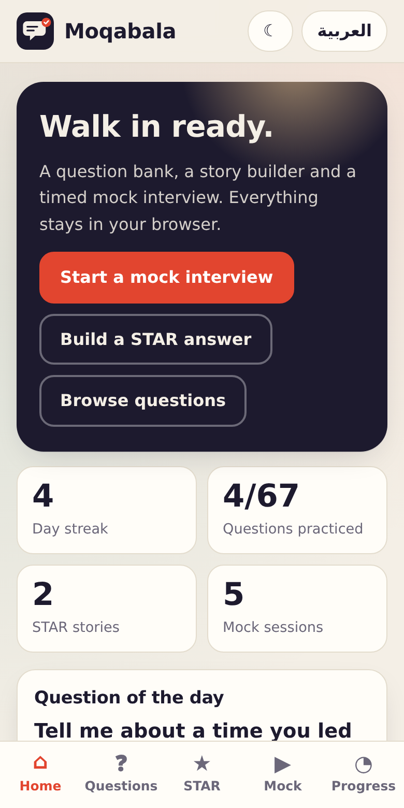
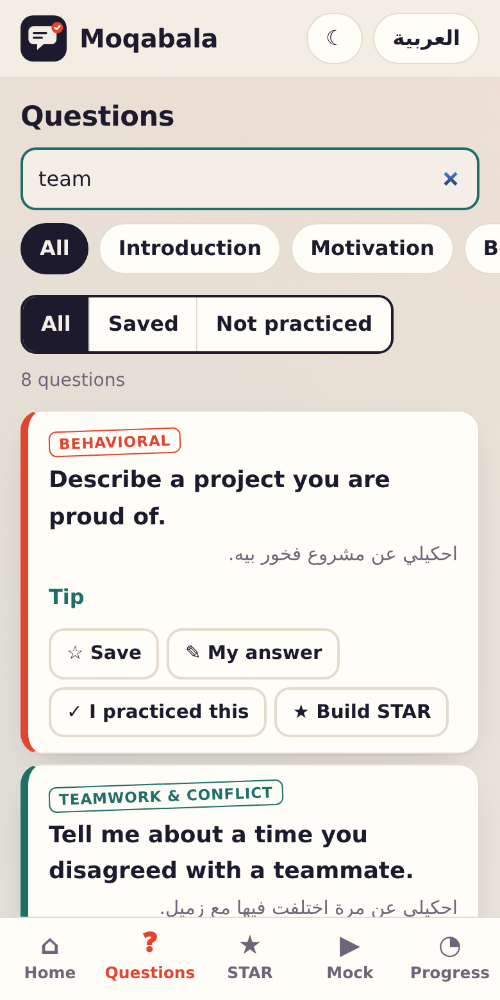
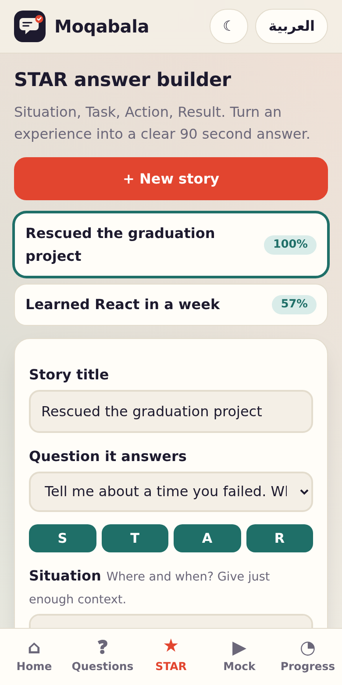
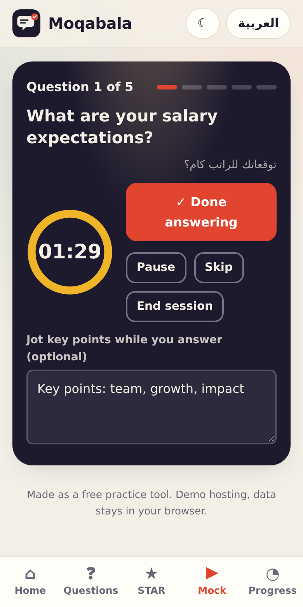
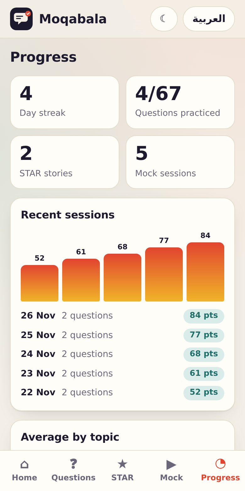
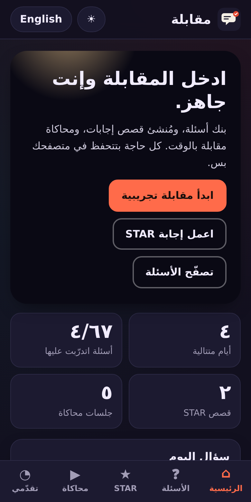

<p align="center"></p>

<h1 align="center">Moqabala | مقابلة</h1>

<p align="center"><b>Practice the interview before the interview.</b><br>
Question bank, STAR answer builder and a timed mock interview. Arabic and English, mobile first, runs entirely in your browser.</p>

<p align="center"><a href="https://yousefkhames.github.io/moqabala/"><b>Open the live demo</b></a></p>

<p align="center">
   
</p>

## The pitch

Most people fail interviews on the same three things: they have no clear story ready, they ramble, and they have never answered out loud under a clock. Moqabala drills exactly those.

1. Pick from **67 real interview questions** in 10 topics, each with a short tip and an Arabic or English version side by side.
2. Turn your experience into a **STAR answer** (Situation, Task, Action, Result) and see whether it is complete, balanced and has a number in the result.
3. Run a **timed mock interview**: random questions, a real countdown, then rate yourself honestly. Watch your score climb over days.

## Features

- **Question bank**: 67 questions in 10 topics (intro, motivation, behavioral, strengths, teamwork, leadership, situational, skills, salary and logistics, questions to ask them). Search, topic filter, save, "not practiced yet" filter, per-question notes, a practiced counter, and your own custom questions.
- **STAR builder**: four guided fields with hints, live completeness meter, warnings (thin situation, no number in the result, too much setup), a combined spoken-answer preview, estimated speaking time at 130 words per minute, copy to clipboard, download as `.txt`. Link each story to a question.
- **Mock interview**: choose topics, 3 to 10 questions, 60 to 180 seconds per answer, optional thinking time. Pause, skip, finish early. Time-up beep and vibration. A notes box that counts filler words ("um", "basically", "يعني", "كده"). Self rating (1 to 5) plus a 4 point checklist turns into a 0 to 100 score. Unpracticed questions are picked first.
- **Progress**: day streak, practiced count, score chart for the last 10 sessions, average per topic, session history.
- **Arabic and English**, full RTL layout, Arabic-Indic digits in Arabic mode. Light and dark theme.
- **Your data**: JSON export and import, one-click erase. Works offline after the first visit (service worker).
- Interview day checklist on the home screen.

## Screenshots

| Progress | Arabic, dark |
|---|---|
|  |  |

## Tech

Plain HTML, CSS and JavaScript. No framework, no build step, no server, no tracking, no network calls.

- `js/logic.js`: pure logic (scoring, STAR checks, streaks, filler words, seeded shuffle, backup validation). Runs in the browser and in Node.
- `js/app.js`: UI and state, saved in `localStorage` under `moqabala:v1`.
- `js/data.js`, `js/i18n.js`: question bank and bilingual strings.
- `sw.js` + `manifest.webmanifest`: offline cache and installable app.

## Run it

```bash
python3 -m http.server 8080   # or any static server, then open http://localhost:8080
```

## Tests

```bash
npm install          # only needed for the browser test (playwright-core)
npm test             # 16 unit tests for the logic and data integrity
npm run e2e -- http://localhost:8080/     # 38 checks in real Chrome
```

The browser test clicks through language and RTL, the checklist, search and filters, notes, custom questions, the whole STAR flow including clipboard and download, a full timed mock (pause, skip, time-up, scoring), export, import, reset, offline cache registration, and checks for horizontal overflow at 390 px and for console errors. It was also run against the live URL.

## Honest limits

- **Your data lives in one browser.** It is `localStorage`: clearing site data, using another browser or a private window means a fresh start. Use Export backup to move it.
- **No speech analysis.** The timer and filler word count work on what you type in the notes box. The app does not record or listen to your voice.
- **Scores are self rated.** The score is your own rating plus your checklist, not an AI judgement.
- **The question bank is general.** It is not tuned to a specific company or field, and the tips are guidance, not guarantees.
- **GitHub Pages is a demo host.** Fine for trying the app. If you want it for a school, a club or a business, host it where you control the domain.

## License

MIT. See [LICENSE](LICENSE).
